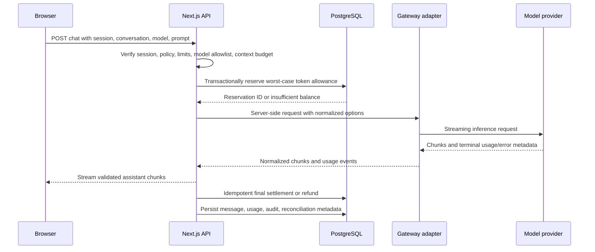

# End-to-end data flows

**Status: Proposed; founder approval required.** The flows below define security and accounting boundaries before implementation.

## Streaming AI chat



The server creates a request ID and idempotency key. It validates the conversation owner, selected model, context window, request size, and policy before reserving. The reservation is a ledger state, not a direct balance overwrite. The stream may be interrupted; the server must settle from verified usage when available, otherwise apply the documented conservative fallback and reconciliation state. A provider failure before billable usage releases the reservation. Any uncertain provider charge remains explicitly marked for reconciliation rather than silently refunded or deducted.

## Rewarded advertising

```mermaid
sequenceDiagram
  participant B as Browser
  participant A as Next.js API
  participant N as Ad network
  participant DB as PostgreSQL

  B->>A: Create ad-show request
  A->>DB: Store pending show with nonce, session, policy snapshot
  A-->>B: show ID and network payload
  B->>N: Request/show rewarded ad
  N-->>B: Client completion callback for UX only
  N->>A: Server callback/postback
  A->>A: Authenticate, validate event, timestamp, nonce, account, replay
  A->>DB: Lock show; calculate capped reward from policy snapshot
  DB->>DB: Insert immutable reward ledger entry exactly once
  A-->>N: Fast 2xx after durable idempotent receipt
  A-->>B: Refresh balance from server
```

No client-only completion grants tokens. A callback with missing or unverified payout data can create a pending/review state but cannot grant beyond the approved fallback policy. Network reporting is ingested separately and reconciled against shows, valued events, rewards, and provider revenue.

## `/out` affiliate link

The client renders a detected markdown link as an interstitial or explicit disclosure. The server accepts only a normalized HTTPS destination whose host and scheme satisfy policy. It first checks a versioned affiliate-rule cache, then performs a direct provider lookup/wrap where permitted. If no direct rule exists, the configured aggregator fallback is attempted. If neither is safe or eligible, the original destination may be shown without affiliate transformation according to policy. The redirect endpoint records a non-sensitive click ID, applies the required disclosure, and rejects arbitrary open-redirect parameters. Provider secrets remain server-side.

## One-time top-up

The server creates a payment order/session and stores a pending payment intent with an idempotency key. The browser completes hosted checkout. The provider webhook is verified using the raw request body and provider secret. Only a trusted success event or server-side verification transitions the intent and creates a top-up ledger entry. Retries, out-of-order events, refunds, disputes, and partial refunds are handled as idempotent state transitions and compensating ledger entries.

## Failure policy

Every externally triggered operation has a durable request or intent before calling the provider. Every callback is safe to retry. A timeout is not equivalent to success or failure until reconciled. User-facing responses must expose a safe pending state rather than inventing final accounting. Provider-specific errors are normalized internally but retained in redacted audit metadata.
