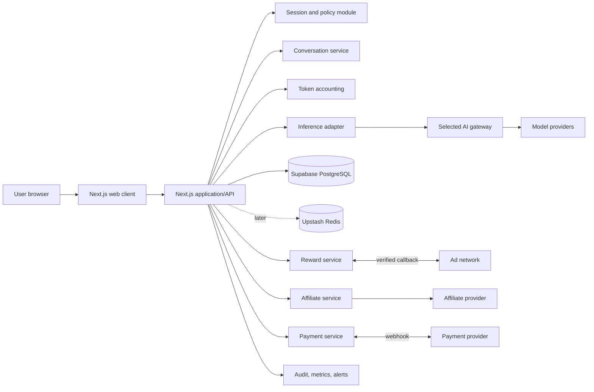

# System overview

**Status: Proposed; founder approval required.** This document is the integrated technical design for Assignment 002. No application implementation, provider integration, migration, or credential exists yet.

## Recommended initial topology

The simplest viable launch is one Next.js App Router application with strict TypeScript, deployed as one Vercel service. The application uses the Vercel AI SDK for streaming and model interaction, an internal gateway adapter for the selected inference gateway, and Supabase PostgreSQL as the sole durable system of record. Supabase server-side pooling is required for serverless traffic. Upstash Redis is deferred until measured requirements justify it for rate limiting, idempotency, caching, or ephemeral coordination.

The recommended inference gateway is OpenRouter, subject to founder approval, because its reviewed documentation explicitly describes a broad multi-provider catalog and routing controls. Vercel AI Gateway remains the documented alternative where Vercel-native observability, budgets, BYOK, deployment integration, or zero token markup outweigh OpenRouter's credit-purchase fee. The application must not expose either gateway credential to the browser.

## Component boundaries

| Component | Responsibility | Launch status |
| --- | --- | --- |
| Web client | Conversation UI, streaming display, ad UX, authenticated navigation, safe `/out` links | Proposed |
| Next.js application/API | Authenticated request boundary, validation, orchestration, policy enforcement, streaming response | Proposed |
| Session/auth module | Guest sessions, Google OIDC verification, application-owned sessions, revocation | Proposed |
| Conversation service | Conversation/message lifecycle, context selection, retention/deletion policy | Proposed |
| Inference adapter | Normalizes gateway requests, model IDs, provider options, streaming, usage, errors, retries | Proposed |
| Token-accounting module | Reservations, immutable ledger entries, settlement, refunds, reconciliation | Proposed |
| Reward service | Ad-show creation, callback verification, fraud checks, reward decision, ledger credit | Proposed |
| Affiliate service | Link detection, allowlist validation, provider lookup/wrapping, disclosure, redirect analytics | Proposed |
| Payment service | Hosted checkout/order creation, webhook verification, top-up ledger, refunds/reconciliation | Proposed |
| PostgreSQL | Durable source of truth for identity, conversations, usage, ledger, rewards, payments, rules, audit | Proposed |
| Redis (later) | Bounded ephemeral coordination only; never authoritative balance or ledger | Deferred |
| Operations/admin | Reconciliation, budgets, alerts, abuse review, provider configuration, support actions | Proposed |

## System context

## Trust boundaries

The browser is untrusted. It may request an operation and display a stream, but it cannot set identity, balance, reward status, usage, provider cost, or payment success. The application/API is the policy boundary. Third-party callbacks are untrusted until signature or documented verification, replay, timestamp, account, and event checks succeed. PostgreSQL is the durable accounting boundary. Provider credentials and signing secrets are server-only.

## Launch versus later

Required for launch are the single application, PostgreSQL, server-owned sessions, Google OIDC if durable accounts are enabled, one selected inference gateway behind an adapter, immutable token accounting, a verified rewarded-ad path if rewards launch, concrete abuse controls, safe affiliate redirects if `/out` launches, and operational audit/reconciliation.

Useful later are Redis for distributed coordination, a durable workflow system for long-running jobs, additional gateway/provider adapters, read replicas, search/vector retrieval, multi-region data, and multiple payment/ad networks. Unnecessary at the current scale are a separate custom backend alongside Next.js, Redis as a second source of truth, a microservice fleet, and active-active multi-region infrastructure without measured requirements.

## Major open assumptions

Workload, model catalog, latency SLO, retention, data residency, provider terms, launch geography, legal obligations, ad eligibility, payout evidence, payment economics, and support ownership are unknown. These are recorded in [`../decisions/founder-decisions.md`](../decisions/founder-decisions.md), not silently assumed.

## Evidence

The gateway and stack recommendation is based on the reviewed official documentation for Vercel AI Gateway, OpenRouter, Vercel AI SDK, Next.js, Supabase, and Upstash. See the References section in [`../decisions/ADR-0002-launch-technology.md`](../decisions/ADR-0002-launch-technology.md).
