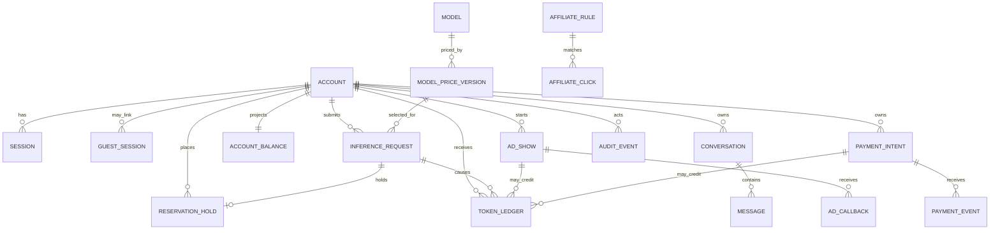

# Conceptual and proposed physical data model

**Status: Proposed; not implemented.** The tables below are a design starting point, not migrations. The final schema, identifiers, retention, and tenancy model require founder/security approval.

## Entities

`accounts` represents a durable user keyed by an internal ID and a stable identity subject such as Google OIDC `sub`. `guest_sessions` represents a short-lived low-privilege session. `sessions` stores application-owned session state and revocation metadata. `conversations` and `messages` store owned chat data with retention and deletion markers.

`models` and `model_price_versions` describe approved model IDs, gateway namespaces, input/output and cached-token prices, effective dates, capability limits, and status. `inference_requests` records idempotency key, account/session, model-price version, reservation-hold reference, provider request ID, terminal state, usage, overage-reconciliation status, and reconciliation status.

`reservation_holds` stores temporary authorization separately from financial history: hold ID, account, request, reserved units, status, created/expiry/settled timestamps, and optional overage-reconciliation reference. `account_balances` is a guarded projection of posted balance, active holds, and available balance. `token_ledger` is an immutable posted financial ledger containing usage debits, rewards, top-ups, refunds, and corrections; it does not contain reservation or release entries. `accounting_requests` provides account-scoped idempotency, request fingerprints, and state transitions.

`ad_shows`, `ad_callbacks`, `reward_policies`, and `reward_reconciliation` track show nonce, session/account, network, callback identity, verification state, policy version, estimated revenue if available, granted amount, and reconciliation outcome. `payment_intents`, `payment_events`, and `payment_reconciliation` track hosted payment state and compensating ledger entries.

`affiliate_rules`, `affiliate_clicks`, and `affiliate_provider_events` store versioned destination rules, disclosure policy, non-sensitive click IDs, provider references, and reporting outcomes. `audit_events` stores actor, action, resource, request ID, redacted metadata, and retention class. `abuse_signals` stores privacy-reviewed, short-retention risk signals and decisions, not raw fingerprints by default.

## Critical constraints

- Unique stable identity subject per identity provider.
- Unique session token hash; raw session tokens never stored.
- Unique `(account_id, idempotency_key)` for balance-affecting requests.
- Unique provider event IDs per network/provider.
- Unique `(request_id, operation_id)` for each posted ledger operation; multiple partial refunds are allowed with distinct operation IDs.
- Unique hold ID and at most one active hold per inference request.
- Check constraints for non-negative hold/usage quantities, supported statuses, and valid state transitions.
- Foreign keys from ledger entries to account and source request/intent.
- Effective-date uniqueness for active model pricing and reward policy versions.
- No client-writable balance or ledger table.

## Indexing and retention

Index owner/account plus conversation update time, request idempotency, request status and created time, active reservation holds by account/status/expiry, ledger account plus sequence/time, callback provider ID, payment provider ID, affiliate destination hash/rule version, and audit actor/resource/time. Partitioning is unnecessary until measured volume requires it. Retain conversation content, audit events, usage, and abuse signals according to approved privacy classes; deletion must preserve the minimum financial/accounting evidence required by law and reconciliation.

## Row-level security requirements

Enable RLS for user-owned conversations, messages, sessions, and account views. Policies must derive ownership from the authenticated application identity, not a client-supplied account ID. Keep service-role operations server-only and narrowly scoped. Ledger, balances, provider configurations, pricing, reward verification, payment events, audit records, and abuse signals are not directly writable by ordinary client roles. Administrative access requires explicit role, audit logging, least privilege, and support redaction.

## ER diagram

## Critical SQL posture

The accounting transactions and guarded updates are specified in [`token-accounting.md`](token-accounting.md). No SQL in this repository is an executable migration until the founder-approved schema and security review are complete.
